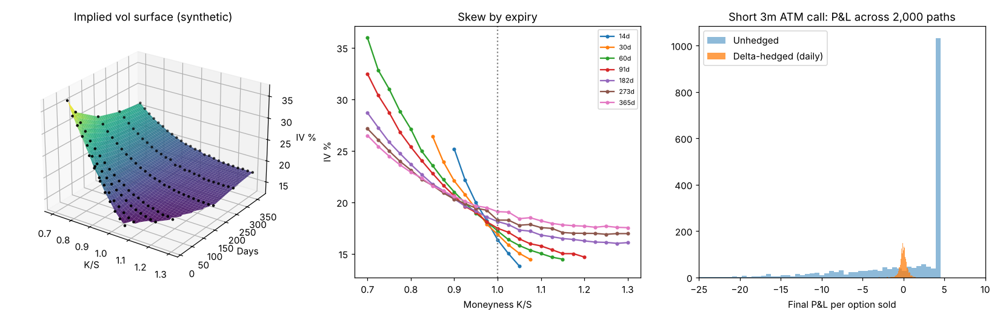

# Vol Surface Lab

An interactive dashboard that pulls live equity option prices, backs out implied volatilities with the Black-Scholes-Merton model, plots the 3D volatility surface, and simulates how a trading desk delta-hedges a short option position.



## What it does

| Module | What it does |
|---|---|
| `pricing.py` | Black-Scholes-Merton prices and Greeks (delta, gamma, vega, theta), plus an implied-vol solver (Brent's method with no-arbitrage bounds checks). Fully vectorised with NumPy. |
| `data.py` | Downloads option chains from Yahoo Finance, cleans them (out-of-the-money only, bid/ask mid, spread and moneyness filters), and generates a realistic synthetic chain for offline use. |
| `surface.py` | Computes implied vol for every option, interpolates the surface, and draws the 3D surface, per-expiry smiles, ATM term structure, and a check of our IVs against Yahoo's. |
| `hedge.py` | Monte Carlo delta-hedging simulator: sell an option, rebalance a stock hedge at a chosen frequency with transaction costs, and measure the P&L distribution. |
| `app.py` | Streamlit dashboard tying it all together. |
| `tests/` | Unit tests: textbook prices, put-call parity, IV round-trips, Greeks vs finite differences, and hedging behaviour. |

## Run it

You need Python 3.10 or newer.

```bash
# 1. Create a virtual environment (keeps packages separate from your system Python)
python -m venv .venv
source .venv/bin/activate          # Windows: .venv\Scripts\activate

# 2. Install packages
pip install -r requirements.txt

# 3. Check the maths
pytest

# 4. Launch the dashboard (opens in your browser)
streamlit run app.py
```

**Live data tip:** Yahoo only shows real bid/ask quotes while US markets are open (9:30am to 4pm New York time, which is roughly 9:30pm to 4am Hong Kong time, shifting an hour later once US clocks change in early November). Outside those hours the app falls back to last-traded prices, which are staler, so the surface looks noisier. The **Synthetic demo** source always works.

Good tickers to start with: `SPY` (S&P 500 ETF), `QQQ` (Nasdaq-100 ETF), `AAPL`, `NVDA`, `TSLA` (a much flatter, sometimes upward skew, interesting to compare).

## Key ideas

**Implied volatility.** The market quotes an option's price; Black-Scholes turns price into a single number, the volatility the market is implicitly pricing in. Comparing that number across strikes and maturities is how desks compare options on a like-for-like basis.

**The skew.** If Black-Scholes were literally true, every option on the same stock would have the same implied vol and the surface would be flat. Real equity surfaces slope down: low-strike puts trade at higher vols because investors pay up for crash protection. The skew is steepest for short maturities.

**Delta hedging.** A desk that sells an option doesn't want to bet on direction. It holds *delta* shares of stock so small price moves cancel out, and rebalances as delta changes. What's left is a bet on **volatility**: if the stock realises more volatility than the implied vol the option was sold at, re-hedging costs more than the premium collected and the desk loses money (it is "short gamma"); if it realises less, the desk keeps the difference.

## Results from the simulator

Selling a 3-month at-the-money call at 20% vol, 2,000 simulated paths (synthetic settings, no transaction costs):

| Scenario | Mean P&L | Std dev of P&L |
|---|---|---|
| Unhedged | ~0 | 147% of premium |
| Delta-hedged daily, realised vol = 20% | ~0 | 9% of premium |
| Delta-hedged daily, realised vol = 30% | about -2.0 (desk loses) | |
| Delta-hedged daily, realised vol = 10% | about +2.0 (desk gains) | |

Hedging error falls roughly with the square root of the number of rebalances (63 trades gives about 7x less noise than one trade), but each trade costs money. That trade-off is what real hedging policy is about.

## Roadmap

- [ ] Fit a smooth parametric surface (e.g. SVI) instead of linear interpolation, and check it for calendar and butterfly arbitrage
- [ ] Pull the risk-free rate from the Treasury curve and infer the dividend yield from put-call parity
- [ ] Add a Greeks heatmap (delta/gamma/vega by strike and maturity)
- [ ] Hedge with real historical prices instead of simulated paths
- [ ] Compare delta-only hedging with delta-gamma hedging (using a second option)

## Limitations

Black-Scholes assumes constant volatility and continuous trading; the whole point of the surface is that markets disagree. US single-stock and ETF options are American-style, so using a European model slightly misprices deep in-the-money options and options around dividends; this project only uses out-of-the-money options, which keeps that effect small. Yahoo Finance data is free but delayed and occasionally incomplete.
